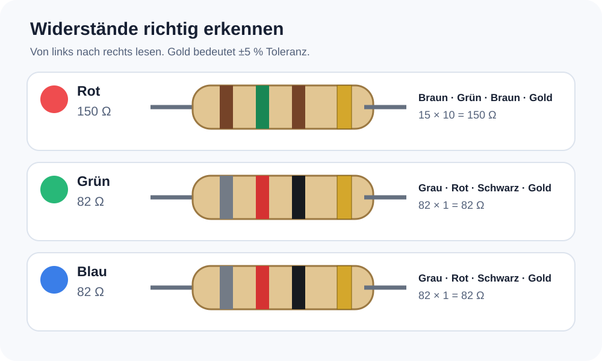
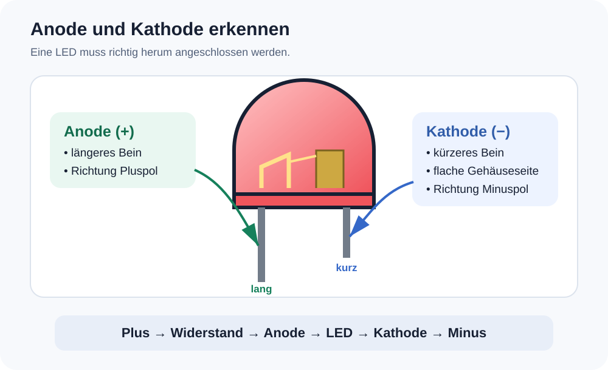

# Mission 2: Die Diskokugel reparieren

Eine Diskokugel mit drei LEDs ist kaputt: Die rote LED leuchtet nicht mehr. Deine Aufgabe ist es, den Fehler zu verstehen, die LED zu ersetzen und die Schaltung zu verbessern.

Dabei lernst du:

- warum eine LED einen Vorwiderstand braucht,
- wie man den Wert eines Widerstands an seinen Farbringen erkennt,
- wie man einen Widerstand mit dem Multimeter misst,
- wie LEDs richtig angeschlossen werden und
- wie man Bauteile aus- und einlötet.

> **Sicherheit:** Arbeite beim Löten immer zusammen mit einer erwachsenen Person. Die Spitze des Lötkolbens und frisch gelötete Stellen sind sehr heiss. Beim Messen und Löten müssen die Batterien entfernt sein.

## 1. Was ist vermutlich passiert?

Die drei AA-Batterien liefern zusammen ungefähr `4,5 V`. Eine LED darf nicht ohne einen passenden Vorwiderstand daran angeschlossen werden. Ein Widerstand von nur `3 Ω` begrenzt den Strom kaum.

Die rote LED benötigt eine kleinere Spannung als die grüne und die blaue LED. Deshalb kann durch sie besonders viel Strom geflossen sein. Das ist eine plausible Erklärung dafür, dass gerade die rote LED ausgefallen ist.

Die Verbesserung: **Jede LED bekommt ihren eigenen Vorwiderstand.**

## 2. Widerstände und ihre Farbringe

Bei einem Widerstand mit vier Farbringen bedeuten die Ringe:

1. erste Ziffer,
2. zweite Ziffer,
3. Multiplikator – wie viele Nullen folgen,
4. Toleranz – wie stark der echte Wert abweichen darf.

| Farbe | Ziffer | Multiplikator |
|---|---:|---:|
| Schwarz | 0 | × 1 |
| Braun | 1 | × 10 |
| Rot | 2 | × 100 |
| Orange | 3 | × 1.000 |
| Gelb | 4 | × 10.000 |
| Grün | 5 | × 100.000 |
| Blau | 6 | × 1.000.000 |
| Violett | 7 | – |
| Grau | 8 | – |
| Weiss | 9 | – |

Der letzte Ring ist häufig **Gold**. Das bedeutet eine Toleranz von `±5 %`.

### Widerstände für diese Reparatur



| LED | Widerstand | Farbringe bei 4 Ringen |
|---|---:|---|
| Rot | 150 Ω | Braun – Grün – Braun – Gold |
| Grün | 82 Ω | Grau – Rot – Schwarz – Gold |
| Blau | 82 Ω | Grau – Rot – Schwarz – Gold |

Beispiel für `150 Ω`:

```text
Braun = 1    Grün = 5    Braun = × 10

                 15 × 10 = 150 Ω
```

Die kleineren `82-Ω`-Widerstände lassen bei Grün und Blau etwas mehr Strom fliessen. Dadurch leuchten diese LEDs kräftig. Sie sind für diese Diskokugel bewusst auf Helligkeit ausgelegt.

## 3. Einen Widerstand mit dem Multimeter messen

### Vorbereitung

1. Entferne die Batterien aus der Diskokugel.
2. Stecke die schwarze Messleitung in **COM**.
3. Stecke die rote Messleitung in die Buchse **V/Ω**.
4. Stelle den Drehschalter auf das Widerstandssymbol **Ω**. Bei einem Multimeter ohne automatische Bereichswahl eignet sich beispielsweise der Bereich `200 Ω` oder `2 kΩ`.

### Messen

1. Berühre mit je einer Messspitze ein Bein des Widerstands.
2. Die Richtung der Messspitzen spielt bei einem Widerstand keine Rolle.
3. Berühre die Metallspitzen während der Messung nicht gleichzeitig mit beiden Fingern.
4. Lies den Messwert ab und vergleiche ihn mit den Farbringen.

Ein `150-Ω`-Widerstand mit `±5 %` darf ungefähr zwischen `142,5 Ω` und `157,5 Ω` liegen. Ein `82-Ω`-Widerstand darf ungefähr zwischen `77,9 Ω` und `86,1 Ω` liegen.

> In einer eingebauten Schaltung können andere Bauteile das Messergebnis verfälschen. Miss einen neuen Widerstand vor dem Einbau. Bei einem bereits eingebauten Widerstand sollte für eine sichere Messung mindestens ein Bein ausgelötet sein.

## 4. Die neue Schaltung

Alle drei Zweige liegen parallel zwischen Plus und Minus. Es gibt **keine direkte Leitung** von Plus nach Minus.

```text
             150 Ω       rote LED
+ 4,5 V  ─┬─/\/\/\───────|>|──┬─  0 V / Minus
          │   82 Ω       grüne LED │
          ├─/\/\/\───────|>|──┤
          │   82 Ω       blaue LED │
          └─/\/\/\───────|>|──┘
```

Jeder Strompfad enthält genau zwei Bauteile:

```text
Plus → Vorwiderstand → LED → Minus
```

Der Widerstand kann vor oder nach der LED sitzen. Wichtig ist nur, dass er mit der LED **in Reihe** liegt.

## 5. Die Polarität der LED

Eine LED ist eine **Leuchtdiode**. Sie lässt Strom nur in einer Richtung fliessen und muss deshalb richtig herum angeschlossen werden:



- **Anode (+):** kommt über den Vorwiderstand an den Pluspol; meistens das längere Bein
- **Kathode (−):** kommt an den Minuspol; meistens das kürzere Bein
- **Flache Gehäuseseite:** kennzeichnet normalerweise die Kathode
- **Grössere Metallfläche im Innern:** ist normalerweise ebenfalls die Kathode

```text
Plus ── Widerstand ── Anode  LED  Kathode ── Minus
                         (+)  |>|    (−)
                              ↑
                         Licht entsteht
```

### Die neue LED mit dem Multimeter prüfen

Der Diodentest ist vor allem für die **neue, funktionierende Ersatz-LED** gedacht. Bei der alten defekten LED funktioniert diese Prüfung möglicherweise nicht mehr.

1. Stelle das Multimeter auf den **Diodentest**.
2. Halte die rote Messspitze an die vermutete Anode und die schwarze an die Kathode.
3. Die neue LED kann dabei schwach leuchten und das Display zeigt ihre Durchlassspannung an.
4. Erscheint keine Anzeige, vertausche die Messspitzen.
5. Die Richtung, in der die neue LED leuchtet oder einen Wert anzeigt, ist die richtige Anschlussrichtung.

> Nicht jedes Multimeter liefert im Diodentest genug Spannung, um eine blaue oder grüne LED sichtbar leuchten zu lassen. Orientiere dich deshalb zusätzlich am langen Bein und an der flachen Gehäuseseite.

Fotografiere und markiere die Anschlüsse der alten LED **vor dem Auslöten**. Ihre Polarität lässt sich nach einem Defekt möglicherweise nicht mehr elektrisch bestimmen. Verlasse dich auch nicht nur auf ihre Beinlänge, weil die Beine bereits gekürzt wurden.

## 6. Reparaturauftrag

### Untersuchen

- [ ] Batterien entfernen.
- [ ] Alte Verdrahtung fotografieren oder aufzeichnen.
- [ ] Plus und Minus auf der Platine finden und markieren.
- [ ] Den alten `3-Ω`-Widerstand identifizieren und messen.
- [ ] Die Polarität aller LEDs bestimmen.

### Vorbereiten

- [ ] `150 Ω` anhand der Farbringe finden und mit dem Multimeter prüfen.
- [ ] Zwei Widerstände mit `82 Ω` finden und prüfen.
- [ ] Die neue rote LED richtig ausrichten.
- [ ] Gemeinsam mit einer erwachsenen Person die geplante Verdrahtung kontrollieren.

### Reparieren

- [ ] Defekte rote LED auslöten.
- [ ] Alte gemeinsame Strombegrenzung entfernen oder entsprechend umbauen.
- [ ] Jede LED mit ihrem eigenen Widerstand in Reihe verbinden.
- [ ] Neue rote LED einlöten.
- [ ] Lötstellen auf Kurzschlüsse und lose Verbindungen kontrollieren.

### Testen

- [ ] Vor dem Einsetzen der Batterien noch einmal prüfen: keine direkte Verbindung zwischen Plus und Minus.
- [ ] Batterien einsetzen und Diskokugel kurz einschalten.
- [ ] Kontrollieren, ob Rot, Grün und Blau leuchten.
- [ ] Ausschalten und prüfen, ob ein Bauteil ungewöhnlich warm geworden ist.

## 7. Denkfragen

1. Warum bekommt jetzt jede LED einen eigenen Widerstand?
2. Weshalb ist der Widerstand der roten LED grösser?
3. Was kann passieren, wenn eine LED verkehrt herum eingesetzt wird?
4. Warum müssen die Batterien beim Widerstandsmessen entfernt sein?

---

Geschafft: Aus einem defekten Gerät ist wieder eine funktionierende Diskokugel geworden – und die neue Schaltung schont ihre LEDs.
